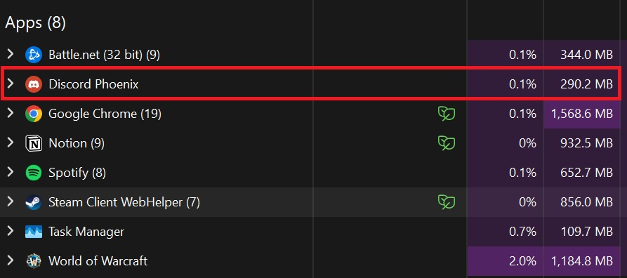

#  shut up

shut up is a tiny tray app that puts discord and spotify in efficiency mode so they stop eating your ram and cpu in the background.
right click the icon, go to **shut it up**, tick what you want to calm down. untick it (or quit) and everything goes back to normal.

## why

discord is rewriting its desktop app in rust to replace electron ([discord phoenix](https://www.tweaktown.com/news/114511/discord-is-replacing-electron-with-a-native-rust-desktop-app-early-windows-build-uses-just-290mb-of-ram/index.html)), and the early build uses way less ram. i couldn't wait for it to come out, so i made this.

<p align="center">
  
  <br>
  <sub>discord phoenix early build in task manager (screenshot from the articles below)</sub>
</p>

once discord phoenix is out i'll stop updating shut up, since the electron version of discord will be dropped anyway.

## what it does

on windows it's the same thing as the "efficiency mode" button in task manager, plus a bit more:

- priority goes to idle and ecoqos is turned on, so the cpu runs them slow and cool.
- their memory priority is set to very low and their working set gets trimmed, so the ram is given back.
- it checks again every 30 seconds, so new discord/spotify processes get caught too.
- your choice is saved, so it's applied again when your pc starts.

on linux it does the same with `SCHED_IDLE`, nice 19, idle io priority and `process_madvise` to page the memory out.

## how much does it save?

measured on my pc with task manager, ram of all the processes added up:

| app | before | after |
|---|---|---|
| discord | ~800-1600 mb | ~100-600 mb |
| spotify (playing music) | ~600-900 mb | ~100-400 mb |

<p align="center">
  
  <br>
  <sub>discord with shut up on, i'm just sitting in a discord conversation and nothing more</sub>
</p>

it depends on what they're doing (in a call discord takes back the ram it needs), so your numbers won't be the same.
shut up itself sits at around 350 kb.

## download

grab `shut-up-setup.exe` from the [releases](../../releases/latest) page and run it. it installs for your user only (no admin), starts with windows and shows up in "installed apps" so you can remove it.

## configuration

on first launch a `config.ini` is created in `%APPDATA%\shut-up` (or `~/.config/shut-up` on linux):

- `refresh_seconds`: how often it applies the settings again (minimum 5).
- `trim_memory`: empties their ram, turn it off if you only want the cpu part.
- `restore_on_exit`: puts everything back to normal when you quit.
- `[Discord]`, `[Spotify]`: each section is an entry in the menu, `processes` is the list of exe names.

want to shut up another app? add a section:

```ini
[Steam]
processes = steam, steamwebhelper
```

it works best on apps built with electron, cef or webview2, they're basically a whole browser running in the background. some you can add:

```ini
[Teams]
processes = ms-teams, teams

[Slack]
processes = slack

[WhatsApp]
processes = whatsapp

[Epic]
processes = epicgameslauncher, epicwebhelper
```

even after discord phoenix comes out, shut up still works for all of these.

## building

you need [rust](https://rustup.rs) and, for the installer, [nsis](https://nsis.sourceforge.io).

```bash
cargo build --release
```

```bash
makensis installer.nsi
```

## linux

you need a desktop with a tray (kde, xfce, cinnamon, or gnome with the appindicator extension).

```bash
./install.sh
```

it goes to `~/.local/bin`, starts with your session, and asks for sudo once to give it `cap_sys_nice` (needed to free the ram and put the priority back). `./uninstall.sh` removes it.

## more

i tested it with discord voice calls, screen streaming and camera on and everything still works fine, so you can leave it on. ty! :3

## sources

about discord phoenix:

- [tweaktown: discord is replacing electron with a native rust desktop app](https://www.tweaktown.com/news/114511/discord-is-replacing-electron-with-a-native-rust-desktop-app-early-windows-build-uses-just-290mb-of-ram/index.html)
- [9to5windows: discord's rust rebuild eats just 290mb of ram](https://9to5windows.com/discord-rust-rebuild-electron-290mb-ram/)
- [windowsforum: discord phoenix, rust and gpui replace electron on windows](https://windowsforum.com/news/discord-phoenix-rust-and-gpui-replace-electron-on-windows-but-290mb-ram-claims-need-testing.450993/)
- [rust bytes: discord's big rust rewrite](https://weeklyrust.substack.com/p/discords-big-rust-rewrite)

## license

you can do whatever you want with it except sell it. if you use it or fork it, credit [@metixw](https://github.com/metixw) or link this repo. see [LICENSE](LICENSE).
